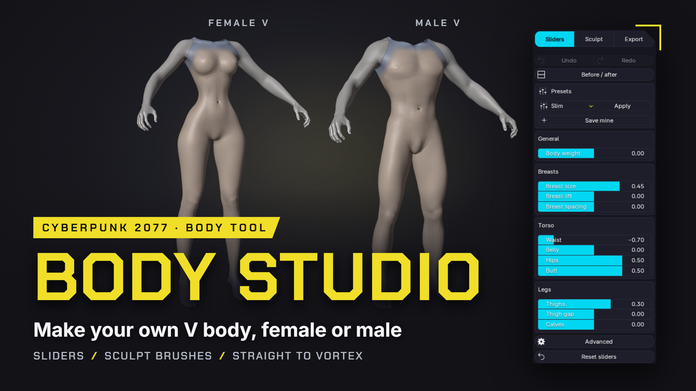

# Body Studio

Make your own V body for Cyberpunk 2077, female or male. Start from the vanilla body or from a body mod you already have, shape it with sliders and sculpt brushes and send it to Vortex.

## Download

### [⬇ Download Body Studio (latest version)](https://github.com/ANIMEFREG/BodyStudio/releases/latest/download/BodyStudio.zip)

1. Unpack the zip anywhere (a short path like `Documents\BodyStudio` is best)
2. Run `BodyStudio.exe`
3. If Windows says "Windows protected your PC", click **More info** and then **Run anyway**

You also need [Blender 4.2 or newer](https://www.blender.org/download/) and the game. The launcher downloads WolvenKit CLI for you with one button, and offers to install the [.NET 10 Runtime](https://dotnet.microsoft.com/download/dotnet/10.0) that WolvenKit needs if it is missing. If you start from a body mod, keep that mod installed. Full guide is in `README.txt` inside the zip.

To refit clothing for your new body, use [Refit Studio](https://github.com/ANIMEFREG/RefitStudio) (exporting the body adds it to Refit Studio by itself).

## What it does

- Female and male V, from the vanilla body or a body mod (tested with vanilla, SLIM THIN, EVE and Adonis)
- Sliders for weight, breasts or pecs, waist, belly, hips, butt and legs, plus advanced sliders
- Presets, your own presets, sculpt brushes with symmetry, before and after view
- Profiles to save and load all your settings, mirror sculpting, a picture of your body for Nexus
- Body check before export (flipped triangles, sharp creases, the body going into the arms)
- The neck, arm joins and feet never move, so the head, arms, cyberware arms and shoes still fit
- The new shape is written into every body file: breast variants, first person view, tattoos, scars, shadow
- No files from other mods are redistributed: the body is built from the vanilla body or from the body mod you have installed

## What is in this repository

- `src/` - the launcher (`BodyStudio.exe`), a single C# WinForms file.
- `core/` - Python scripts that run inside Blender (body base, sliders, workshop panel, export) and the `workshop.blend` scene.

The release archive contains exactly these files plus the built `BodyStudio.exe` and readme files.

## Build from source

Requirements: Windows 10 or 11. No extra tools needed - it uses the C# compiler that ships with Windows (.NET Framework 4, `csc.exe`).

1. Open the `src` folder.
2. Run `build.bat`.
3. `BodyStudio.exe` is created in the repository root.

`core/` is plain Python source, nothing to build.

## Changelog

### 0.2.0

- Profiles: "Save profile" (or Ctrl+S) keeps all your settings, load one to get your body back
- The workshop always opens with a clean body
- On close it asks to save a profile if something changed
- Symmetry is on by default and can be turned off with a checkbox
- Mirror sculpting copies one side of the body to the other
- Picture for Nexus saves front, side and back views of your body
- Exporting to Vortex or zip adds the body to Refit Studio by itself
- Smooth rounded corners in the launcher, offer to make a desktop shortcut

### 0.1.0

- First release
- Female and male V, from the vanilla body or a body mod
- Sliders, advanced sliders, presets, sculpt brushes with symmetry
- Before and after, body check, export to Vortex or zip
- Add to Refit Studio
- The launcher checks for the .NET 10 Runtime that WolvenKit needs and offers to install it
